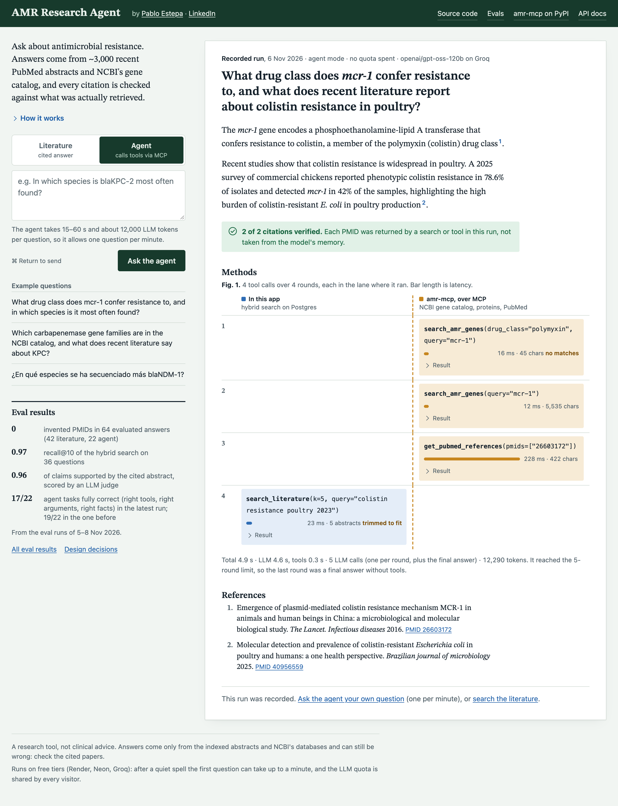
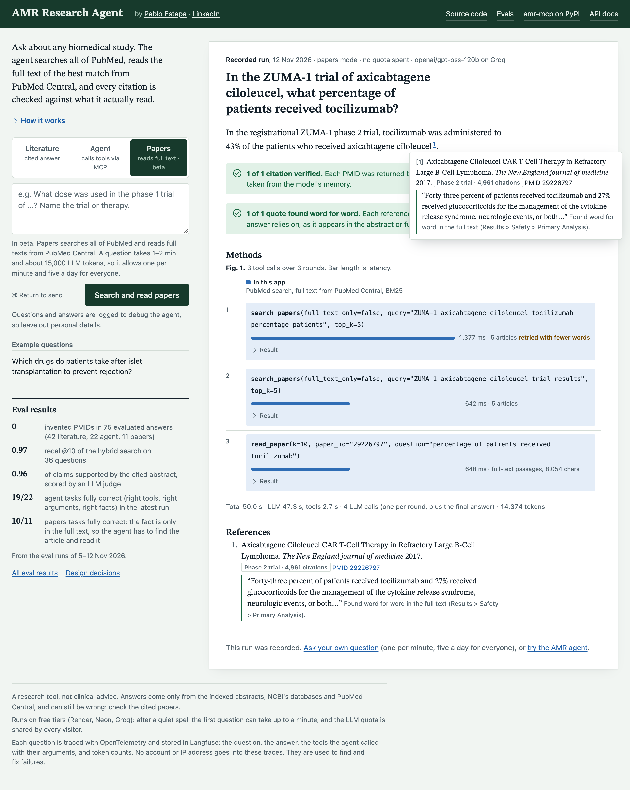
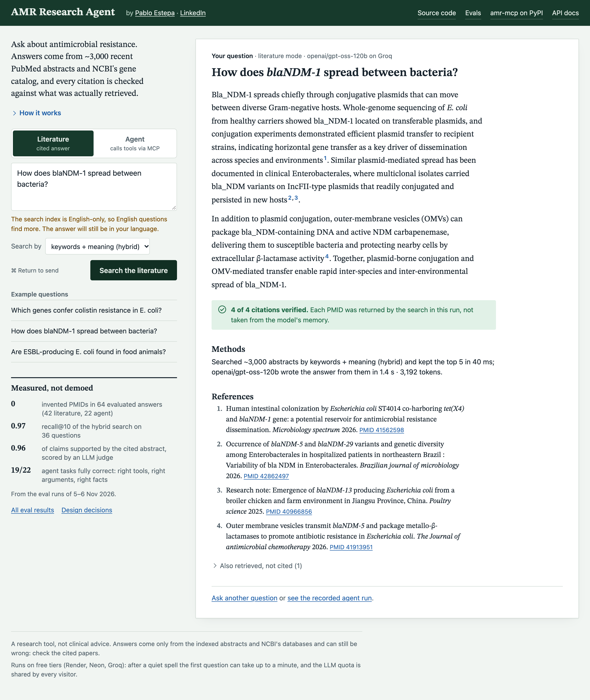
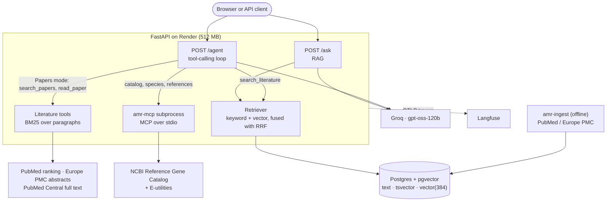
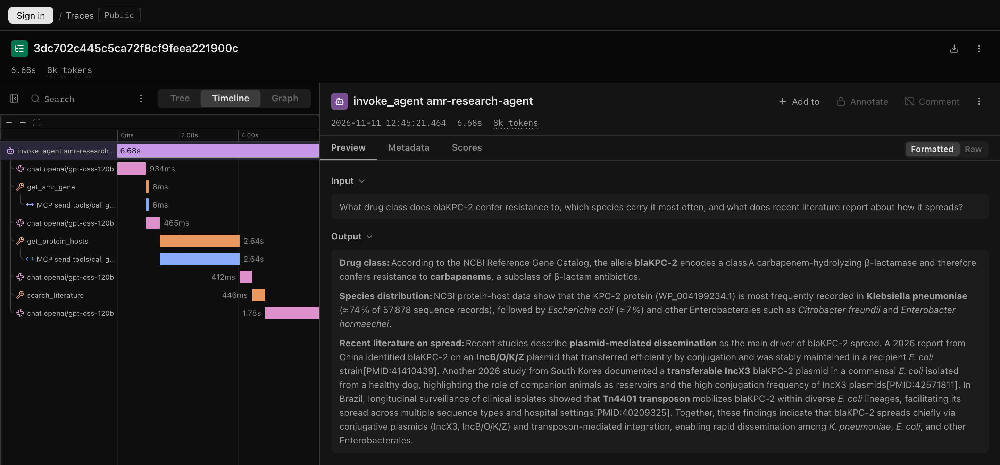

# AMR Research Agent

[](https://github.com/pabloestepaa/amr-research-agent/actions/workflows/ci.yml)


A research assistant for antimicrobial resistance (AMR). It answers questions with hybrid RAG
over ~3,000 recent PubMed abstracts, and with a tool-calling agent that also queries NCBI's AMR
gene catalog and sequence records through [`amr-mcp`](https://pypi.org/project/amr-mcp/), an MCP
server I wrote and published. A third mode, in beta, goes beyond AMR: it searches all of PubMed
and reads full-text articles to find the figure a question asks for, which is rarely in the
abstract, and quotes the sentence behind each citation. Every citation is checked against what
the tools actually returned, every quote word for word, and evals measure retrieval, answers and
agent trajectories.

**Live demo: <https://amr-research-agent.onrender.com>** ·
[straight to the Papers mode](https://amr-research-agent.onrender.com/?mode=papers) · API docs at
[`/docs`](https://amr-research-agent.onrender.com/docs)
<sub>Free tier: after 15 minutes idle, the first request takes 30–60 s while the server wakes up.</sub>

<p align="center">
  <a href="https://amr-research-agent.onrender.com">
    
  </a>
</p>

- Hybrid retrieval (Postgres full-text and pgvector, fused with Reciprocal Rank Fusion) reaches
  recall@10 of 0.97 on a 36-question golden set; vector search alone gets 0.86.
- The agent is a tool-calling loop written by hand, without a framework. It chains catalog
  lookups, NCBI protein records and the literature search, within limits on steps, tokens and
  calls per step.
- To find a fact inside a full-text article, `read_paper` ranks its paragraphs with BM25, with
  no embeddings and no index. On LitQA2, the passage that holds the answer is in the top 8 for
  92 % of the questions.
- A PMID only counts as a citation if a tool returned it. In 42 RAG answers, 22 agent tasks and
  14 Papers tasks, no answer cited a PMID that no tool had returned.
- Evals run at three levels: retrieval on every push, with thresholds that fail CI; answers,
  scored by an LLM judge; and agent trajectories, checked with deterministic rules against
  recorded tool responses.
- Everything runs on free tiers: Render (512 MB), Neon Postgres and Groq. CI builds the Docker
  image and runs it under the same 512 MB limit.

## What it does

The API has three ways to ask, which are the three tabs of the demo:

- `POST /ask` (tab *Literature*): classic RAG. Search the abstracts, then answer citing them as
  `[PMID:x]`.
- `POST /agent` (tab *Agent*): the model decides which tools to call and in what order, then
  answers. The response includes the full trajectory: each tool call, its arguments, latency and
  result.
- `POST /agent/stream`: the same as Server-Sent Events. Each round, each tool call as it
  finishes and each wait for the LLM quota arrive as they happen, then the answer. The demo uses
  it to draw the trajectory live.
- `POST /agent` with `"mode": "literature"` (tab *Papers*, beta): the same loop with two other
  tools. `search_papers` searches all of PubMed live, and `read_paper` reads an article's full
  text from PubMed Central and returns the passages that best match the question. It is meant
  for questions like "what share of ZUMA-1 patients received tocilizumab?", whose answer is in a
  results table and not in the abstract. Each citation comes with the sentence it relies on, and
  the API checks that sentence word for word against what the tools returned. In the demo,
  pointing at a citation number, or tabbing to it, shows the reference and that sentence without
  scrolling down to References. References also
  show the study type from PubMed (phase 2 trial, meta-analysis, review...) and, from 10 up, how
  often the article has been cited.

An example from the agent evals (task `multi-01`), which needs two different sources:

> **What drug class does mcr-1 confer resistance to, and what does recent literature report about
> polymyxin resistance in poultry?**
>
> 1. `get_amr_gene({"name": "mcr-1"})`: NCBI Reference Gene Catalog
> 2. `search_literature({"query": "polymyxin resistance poultry 2023 2024 2025", "k": 5})`
> 3. `search_literature({"query": "colistin resistance poultry 2024", "k": 5})`
>
> According to the NCBI Reference Gene Catalog, the **mcr-1** gene family encodes a
> phosphoethanolamine-lipid A transferase that confers resistance to **colistin (polymyxin E)**,
> which is classified under the COLISTIN drug class.
>
> Recent literature shows that the prevalence of polymyxin (colistin) resistance in poultry varies
> by region. A national survey of Australian meat chickens found **no colistin-resistant E. coli**
> among 2,950 isolates [PMID:41759465]. In contrast, studies from Algeria and Pakistan reported
> higher rates: 3.9 % phenotypic colistin resistance in broiler breeders and laying hens, with 78 %
> of resistant isolates carrying **mcr-1** [PMID:41238024]; and **24.8 % colistin-resistant E. coli**
> in broiler chickens [PMID:40777829]. *(trimmed)*

The demo page at `/` opens on a recorded agent run, so you can see an answer and its tool calls
without waiting or spending quota. The Papers tab has its own recorded run, and
[`/?mode=papers`](https://amr-research-agent.onrender.com/?mode=papers) opens the page on it. From
there you can ask your own question in any of the three modes.

<details>
<summary>Screenshot of the Papers mode</summary>
<p align="center"><a href="https://amr-research-agent.onrender.com/?mode=papers"></a></p>
</details>

<details>
<summary>Screenshot of the literature (RAG) mode</summary>
<p align="center"></p>
</details>

## Architecture



- Ingestion ([`ingest/`](src/amr_agent/ingest/)): NCBI E-utilities, falling back to Europe PMC
  when NCBI search is down. One row per abstract (no chunking: abstracts are short), with its text,
  a `tsvector` for keyword search and a 384-dimension embedding from `bge-small-en-v1.5`, computed
  locally with ONNX ([`embeddings.py`](src/amr_agent/embeddings.py)).
- Retrieval ([`retrieval.py`](src/amr_agent/retrieval.py)): full-text and vector search run in
  parallel and are fused with RRF. Keyword search ignores terms present in more than 10 % of the
  corpus, which `ts_rank_cd` alone would not (it has no IDF).
- RAG ([`rag.py`](src/amr_agent/rag.py)): each source is labelled with its PMID in the prompt,
  the answer cites them as `[PMID:x]`, and there is a fixed refusal message when the sources do
  not answer the question.
- Agent ([`agent.py`](src/amr_agent/agent.py), [`tools.py`](src/amr_agent/tools.py)): a loop of
  about fifty lines. Tools are the literature search plus four `amr-mcp` tools reached through a
  real MCP client. Results are trimmed to 6,000 characters, independent calls run in parallel, and
  when a limit is hit the model is asked for a final answer with the evidence it has.
- Papers mode ([`tools.py`](src/amr_agent/tools.py), [`fulltext.py`](src/amr_agent/fulltext.py)):
  PubMed's Best Match ranks the articles and Europe PMC supplies their abstracts in one request.
  A search with no results is retried with fewer words before the model sees it.
  `read_paper` fetches the JATS XML with `efetch db=pmc`, keeps paragraphs, figure captions and
  tables with their section, and ranks them with BM25. The passages share a fixed budget by rank,
  so a long paragraph is cut to its best sentences instead of pushing the others out.
  [`quotes.py`](src/amr_agent/quotes.py)
  looks for each quoted sentence in those passages and abstracts. Each mode has its own prompt,
  tools and step limit, so the AMR agent and its evals are untouched.
- LLM client ([`llm.py`](src/amr_agent/llm.py)): any OpenAI-compatible API through `base_url`.
  It retries rate limits only when the wait is short, so the API fails fast instead of hanging.

## Evals

Three layers, from cheap and deterministic to expensive and manual. Methodology and golden sets
are in [`evals/README.md`](evals/README.md); full tables, regenerated with `amr-eval-report`,
are in [`evals/RESULTS.md`](evals/RESULTS.md).

| Layer | What it measures | How | When |
|---|---|---|---|
| Retrieval | recall@k, MRR, nDCG@10 per search mode | 36 reviewed questions, local embeddings, no LLM | every push; CI fails below [thresholds](evals/thresholds.json) |
| Answers | faithfulness, relevance, citation validity, abstention | RAG + an LLM judge from a different model (`gpt-oss-20b`) | manual or weekly |
| Agent | right tools, right arguments, facts in the answer, refusals, cost | 22 reviewed tasks, deterministic rules, recorded tool responses | manual |
| Papers agent | found and read the right article, the fact in the answer, quotes found word for word, refusals, cost | 14 tasks: 9 figures that are in a full text but not in its abstract, 3 general questions, 2 out of scope | manual |

**Retrieval** (full corpus, 2,999 abstracts, 36 questions):

| mode | recall@1 | recall@5 | recall@10 | MRR | nDCG@10 |
|---|---|---|---|---|---|
| **hybrid** | 0.72 | 0.86 | **0.97** | **0.80** | **0.84** |
| vector | 0.72 | 0.86 | 0.86 | 0.78 | 0.80 |
| keyword | 0.50 | 0.75 | 0.89 | 0.61 | 0.68 |

Keyword search alone is weak on paraphrases (recall@5 0.50) and vector search on exact gene names
(0.83 against 0.92); hybrid holds up on both.

**Answers** (42 questions, 6 of them out of scope): faithfulness 0.96, relevance 0.99, no
hallucinated PMIDs, every in-scope answer cites a source; 5 of 6 out-of-scope questions refused,
but also 6 of 36 in-scope questions wrongly refused. This run predates the keyword-search fix
below, which retrieves the relevant abstract more often; a re-run is pending.

**Agent** (22 tasks over catalog, species, references, literature, multi-tool and out-of-scope
questions): 19/22 tasks fully correct in the latest run, right tools and right arguments in
every task, expected facts in every answer that should have them, all out-of-scope questions
refused, no hallucinated PMIDs, no crashes, ~4,560 tokens per task. The four runs so far scored
19, 17, 19 and 19 out of 22: each of the first three found failures that led to the fixes below,
and Groq is not deterministic even at temperature 0, so a run moves by a few tasks. Two of the
three failures left are refusals, unchanged by a looser abstention rule (decision 32): the
agent retrieved the right abstract and still said it had no evidence, because the abstract
answers in other words (an ESBL-producing strain is resistant to
cephalosporins; myricetin is a polyphenol). The third is a search that added "2023 2024" to its
query and missed the relevant abstract.

**Papers agent** (9 cell-therapy questions whose answer is only in the full text, 3 general
questions such as the share of patients who stop needing insulin after an islet transplant, 2
out of scope): 12/14 in the latest run, and 10/11 again on the tasks of the earlier runs (7/11 in
the first). The right article came up in all 9 full-text tasks (8 of 9 before): 7 of 18 searches
matched nothing as written, and the retry with fewer words (decision 45) found articles for all
seven. All 10 citations came with a quote, and all 10 quotes were found word for word in what the
tools returned. Both out-of-scope questions were refused and no answer cited a PMID that no tool
had returned. Cost went up: ~8,900 tokens per task on the same tasks, against ~6,400, because
decisions 40 to 43 added about 550 tokens to a prompt that every round sends again, and ~65 s per
question at the median, mostly waiting for the per-minute quota. Both failures stopped at the
token limit after reading an article whose passages lacked the figure. One paper writes "median
DoR" and BM25 put that paragraph 11th for the agent's question; a shorter question would have
reached it, but each article can be read once (decision 40). The other search found only reviews
without figures. This run had the AMR agent's 12,000-token budget instead of the 16,000 of the
deployed Papers agent; the eval now uses the API's (decision 46).

Before the agent, `read_paper` was measured on its own. It finds the passage with the answer
in the top 8 for 0.92 of the LitQA2 questions (FutureHouse, 131 with open full text) and in the
top 10 for 0.92 of 24 paraphrased cell-therapy questions. Embeddings fused with BM25 gained a
few points in the top 5, at the cost of ~9 s per article (decision 33).

### What the evals caught

Each of these problems looked fine by eye and only showed up in the numbers:

- Hybrid search was worse than vector search alone (MRR 0.66 against 0.78). Postgres
  `ts_rank_cd` has no IDF, so abstracts repeating "resistance" and "E. coli" outranked those
  matching the rare, informative term. Dropping query terms present in more than 10 % of the corpus
  fixed it: hybrid MRR 0.80, recall@10 0.86 → 0.97.
- The API reported zero citations for a correct answer: `gpt-oss` sometimes writes
  `【PMID:x】` instead of `[PMID:x]`, and the agent evals later showed `【3†PMID:x】`, `(PMID x)` and
  several PMIDs in one bracket. Citations are now parsed tolerantly and then validated.
- The agent crashed at its step limit. Asked for a final answer with `tool_choice="none"`,
  `gpt-oss` kept calling tools: Groq returned a 400, or the call leaked into the answer as text.
  The final turn is now a fresh conversation with no tools in it.
- Groq returned a 400 for an out-of-range argument (`k=10` with a schema maximum of 6). Numeric
  bounds now go in the description and are enforced on our side, where an error is recoverable.
- The agent kept rephrasing the same literature search until it hit the step limit (5 of 22
  tasks), and answered gene questions from the literature instead of the gene catalog. Replaying
  its queries showed the relevant abstract almost always came up in the first or second search,
  so searches are now capped at two per question and the prompt says which tool fits each kind
  of question. Step-limit hits went from 5 to 0, tool choice from 0.89 to 1.00, and tokens per
  task fell by 29 %.
- The Papers agent missed articles that a quoted search puts in the first two results. PubMed
  translates `CAR T` into `car t[Author]`, a search for an author named "Car T", so most
  cell-therapy queries matched unrelated papers. The query now sends `"CAR T"` as a phrase. Replaying the agent's own
  recorded queries against PubMed, two of the four missing articles came up. In the next run the
  right article came up in 8 of 9 tasks, against 5 of 9 before.
- `read_paper` gave the model fewer passages than it asked for. A paragraph is never split, so one
  can run to 3,000 characters, and when the result went over its size limit the trimming cut the
  list of passages in half. In a failed task the figure was in the fifth of five passages, after a
  2,665-character paragraph. On LitQA2, more than half of the reads were cut, and the answer
  reached the model for 0.87 of the questions while BM25 had it in the top 8 for 0.92. The
  passages now share a budget by rank, the long ones cut to their best sentences: 0.92 arrive,
  with 12% more text (decision 46).
- One failure was the evaluator's fault: a correct answer failed because `gpt-oss` writes
  "Escherichia coli" with a narrow no-break space. Facts are now compared after Unicode
  normalisation.

## Observability

Every `/ask` and `/agent` request in production is a trace in [Langfuse](https://langfuse.com)
(free Hobby plan). The spans follow OpenTelemetry's
[GenAI semantic conventions](https://github.com/open-telemetry/semantic-conventions-genai) and
are written by hand in [`telemetry.py`](src/amr_agent/telemetry.py), so any OTLP backend can
receive them. An agent question looks like this:

```
invoke_agent amr-research-agent       question, answer, total tokens, stop reason
├─ chat openai/gpt-oss-120b           tokens, finish reason, latency of each turn
├─ execute_tool get_amr_gene          arguments, PMIDs returned, error
│  └─ MCP send tools/call get_amr_gene    created by the mcp SDK
├─ execute_tool search_literature
└─ chat openai/gpt-oss-120b
```

<p align="center"></p>

This trace shows something the evals never measured. The four LLM calls took 3.6 s in total,
and one `get_protein_hosts` call took 2.6 s, almost all of it waiting on NCBI. A trace keeps
only the question, the final answer and the tool arguments, without prompts or tool results,
because the questions come from a public demo. The page tells visitors so. Without an OTLP
endpoint, tracing is off and the SDK is not imported. See decision 39.

## Design decisions

All 46 decisions, with context and trade-offs, are in [`docs/decisions.md`](docs/decisions.md).
The ones that shaped the project most:

| Decision | Why | Trade-off |
|---|---|---|
| Postgres + pgvector for text, keywords and vectors | one system to run, transactional upserts, plain SQL; 3,000 abstracts take ~27 MB | no built-in BM25, so keyword ranking needed the document-frequency fix above |
| No chunking: one row per abstract | abstracts are short and self-contained, and one PMID = one citable source | to revisit if full texts are ingested |
| Validate citations against what was retrieved | a PMID counts only if retrieval or a tool returned it; the rest go to `invalid_citations` | tolerant parsing has to keep up with each model's citation habits |
| Papers answers quote their source, checked by code | the reader sees where a figure comes from without opening the article, and a reworded quote is flagged | a few more output tokens; the quote stays in English under a Spanish answer |
| Hand-written agent loop, no framework | every message sent to the model is visible, and a scripted fake LLM tests the loop | no persistent state or branching graphs, which this agent does not need |
| `amr-mcp` through a real MCP client in a subprocess | the project shows both sides of MCP; the client works with any MCP server | ~95 MB of the 512 MB budget (the container measures 367 MiB) |
| Own eval metrics instead of Ragas or DeepEval | each metric is a few tested lines, and the judge prompt is versioned with the code | fewer metrics out of the box |
| BM25 over each article's paragraphs, no embeddings, in `read_paper` | 0.92 of LitQA2 passages in the top 8, with no index and no model | embeddings fused with RRF gained a few points in the top 5 but cost ~9 s per article |
| No cross-encoder reranker | it raised MRR to 0.85, but took ~4 s per query and over 1 GB of RAM | worth adding on paid hosting or with a hosted rerank API |
| Fail fast on LLM rate limits | with the daily quota spent, a 503 in 0.5 s beats a 35 s spinner ending in the same error | the evals, which can wait, allow longer retries |

## Run it locally

Requirements: Python 3.13, [uv](https://docs.astral.sh/uv/), PostgreSQL 17 with
[pgvector](https://github.com/pgvector/pgvector), and a free [Groq API key](https://console.groq.com/keys)
(any OpenAI-compatible endpoint works).

```bash
cp .env.example .env        # set DATABASE_URL and LLM_API_KEY
uv sync
uv run amr-ingest --max 3000                      # fetch, embed and index abstracts (idempotent)
uv run uvicorn amr_agent.api.main:app --port 8011 # demo at /, API docs at /docs
```

Tests use no network and no API keys (fake LLM and retriever, `amr-mcp` in-process), only a
throwaway database:

```bash
DATABASE_URL_TEST=postgresql://localhost/amr_agent_test uv run pytest -q
uv run ruff check .
```

Evals (the last two spend LLM quota):

```bash
export DATABASE_URL_EVAL=postgresql://localhost/amr_agent_eval
uv run amr-eval-retrieval --load-corpus --check   # as in CI
uv run amr-eval-answers                           # ~150k tokens, ~25 min on Groq Free
uv run amr-eval-agent --load-corpus               # ~130k tokens
uv run amr-eval-agent --mode literature           # Papers agent, no database, ~140k tokens
uv run amr-eval-report                            # rewrites evals/RESULTS.md
```

Deployment to Render and Neon is described in [`docs/deploy.md`](docs/deploy.md).

## Stack and limitations

Stack: Python 3.13 · FastAPI · PostgreSQL + pgvector (Neon) · fastembed (`bge-small-en-v1.5`,
ONNX) · OpenAI SDK against Groq (`gpt-oss-120b`, judge `gpt-oss-20b`) · MCP (`mcp` client,
[`amr-mcp`](https://github.com/pabloestepaa/amr-mcp) server) · pytest · ruff · Docker ·
OpenTelemetry (GenAI conventions) + Langfuse · GitHub Actions · Render.

Limitations:

- The corpus is small and recent: ~3,000 abstracts from 2022–2026, with no full texts.
- The Papers mode can only read articles that are in PubMed Central, 70 % of those in LitQA2.
  It is in beta: it searches the live PubMed, which needs precise keywords, and the eval only
  has 9 in-scope tasks, written from articles and not yet by a real user. Answers in Spanish
  still keep some English acronyms, such as CRS for *síndrome de liberación de citocinas*.
- The embeddings are English-only, so questions in other languages retrieve worse. The agent is
  told to query the literature in English, which helps.
- The eval sets are small (36 retrieval questions, 42 answers, 22 agent tasks, 14 Papers tasks): enough to catch
  regressions and compare options, but not for tight confidence intervals. The keyword threshold
  (10 %) was tuned on the same questions it is measured on.
- Results are not deterministic: even at temperature 0, the same agent task can take a different
  path from one run to the next.
- The free tiers set limits: the demo sleeps when idle, and the demo and the evals share Groq's
  daily token budget, so the demo has per-IP and daily quotas.
- It is a research tool, not clinical advice. Answers summarise abstracts and public databases and
  can be wrong; check the cited sources.

## License

MIT, see [`LICENSE`](LICENSE).
